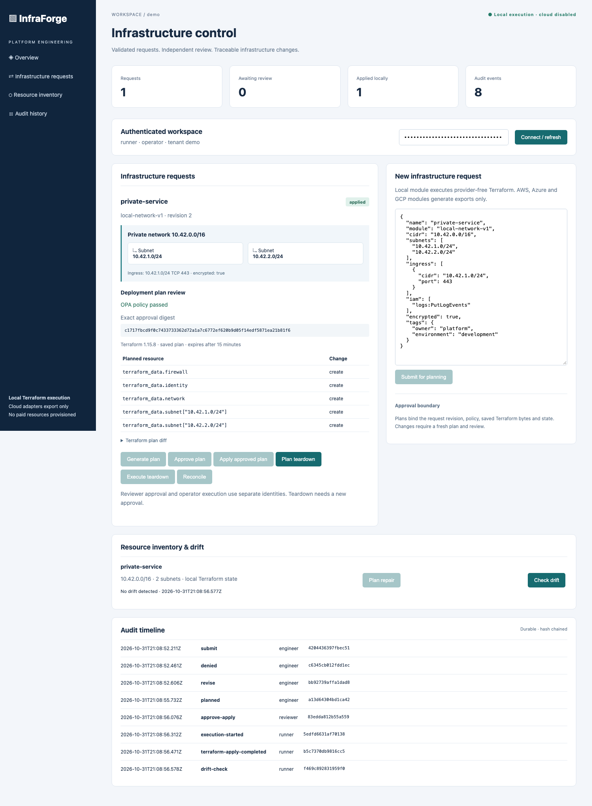

# InfraForge

[](https://github.com/jayekwere/infraforge/actions/workflows/verify.yml)
[](LICENSE)

**Self-service infrastructure requests with durable approvals and a working offline Terraform lifecycle.**

InfraForge owns request validation, network reservations, approval, execution and recovery. TypeScript REST API and CLI, React dashboard, SQLite transactions with encrypted documents, encrypted state and plan storage, real Terraform saved plans, and independent local OPA/Rego enforcement. Python provides an export-based drift comparator.



**Paid provisioning is blocked.** Local Terraform uses built-in `terraform_data` resources. Administrator-configured AWS targets can execute only isolated VPC networking, with exact-plan approval and a separate teardown approval. AWS execution was verified offline with a real provider plan and simulated credentials/execution, without live AWS calls. Azure and GCP remain exports. This is not a production-ready service.

## Quick start

Requires Node 24.13+ or Node 26, and `unzip`. Initial setup downloads locked packages and checksum-verified OPA 1.22.0 and Terraform 1.15.8. Core tests, demo, browser tests and local execution then work offline. Cloud adapter schema validation requires provider downloads on its first run.

```sh
git clone https://github.com/jayekwere/infraforge.git
cd infraforge
npm ci --ignore-scripts
node scripts/install-opa.mjs
node scripts/install-terraform.mjs
npm run verify
npm run dev
```

Open [http://127.0.0.1:8080](http://127.0.0.1:8080). The development launcher creates a separate `.keys/state.key` for a fresh setup and four strong role tokens in `.keys/identities.json`, permission 0600. Copy the requester token from that local file into the dashboard. Switch to the separate approver and operator tokens for approval and execution. Tokens stay in browser memory; changing identities clears the displayed workspace.

1. Submit a request using the supplied JSON editor.
2. Generate the plan. Public ingress, out-of-network ingress, unsafe IAM actions and missing encryption are blocked by OPA.
3. Use **Edit request** to correct a denied configuration and generate a new plan.
4. Connect as the reviewer and approve the exact plan digest.
5. Connect as the operator and apply the saved plan. Review the inventory and run **Check drift**.
6. Use **Plan teardown**, reconnect as the reviewer to approve that destroy plan, then reconnect as the operator to **Execute teardown**.

Server configuration: `INFRAFORGE_IDENTITIES` is a token-to-identity JSON map. Each identity has `id`, `tenant` and a single `role`: requester, approver, operator or viewer. Tokens must have at least 32 characters. Use distinct identities, not merely different tokens for one person. The administrator is trusted to configure identities correctly. The server requires `INFRAFORGE_KEY_FILE` outside the data directory. Existing 0.2 data needs an explicit offline migration; see [encryption and key rotation](docs/encryption.md). Default data directory is `.data`; override with `INFRAFORGE_DATA_DIR`. Default bind is loopback. Do not expose the API directly to a public network.

## Offline demonstration and evidence

```sh
npm run demo
```

The demo rejects public SSH ingress, corrects the request, rejects self approval, approves the plan independently, closes and reopens SQLite, restores that approval, executes a real provider-free Terraform apply, checks drift, blocks unapproved destruction, then executes an independently approved saved destroy plan. It uses a disposable private directory and removes it when finished. No cloud accounts or billable resources are required.

The [recorded result](docs/evidence/demo.json) includes actual Terraform plan JSON, plan and policy hashes, durable audit events and teardown evidence. UUIDs, Terraform IDs, timestamps and binary plan hashes vary on each run. Reproducibility means the same validated transitions and outcomes, not byte-identical evidence.

## CLI and API

```sh
export INFRAFORGE_TOKEN='<token from your local identity file>'
node dist/src/cli.js list
node dist/src/cli.js submit examples/local/request.json
node dist/src/cli.js plan REQUEST_ID
```

Save `{"digest":"EXACT_DIGEST_FROM_THE_PLAN"}` as `approval.json`. With the appropriate separate tokens:

```sh
node dist/src/cli.js approve REQUEST_ID approval.json
node dist/src/cli.js apply REQUEST_ID approval.json
node dist/src/cli.js drift REQUEST_ID
node dist/src/cli.js plan-destroy REQUEST_ID
```

The destroy plan produces a new digest. Approve it with the reviewer token and execute `destroy REQUEST_ID teardown-approval.json` with the operator token. `revise REQUEST_ID request.json`, `plan-repair REQUEST_ID`, and `reconcile REQUEST_ID` support correction and recovery. See the [API contract](docs/api.md) and [request schema](schemas/request.schema.json).

## Cloud adapters

| Adapter | Generated resources | Verification | Execution |
| --- | --- | --- | --- |
| Local | Network, subnets, firewall, identity and optional compute/DNS/load-balancer configuration as `terraform_data` | Real plan, apply, readback, drift, repair and teardown | Enabled, no cloud resources |
| AWS | Private VPC/subnets, isolated route tables and security groups; optional service exports | Provider 6.20.0 schema validation, real offline plan and simulated lifecycle tests | Isolated networking only, explicit administrator opt-in; paid services blocked |
| Azure | Resource group, VNet/subnets, NSG associations, explicit inbound/outbound segmentation | Provider 4.50.0 schema validation | Disabled |
| GCP | Custom network/subnets, private Google access, private ingress and denied egress, removed default routes | Provider 7.10.0 schema validation | Disabled |

Change the request `module` to `aws-network-v1`, `azure-network-v1` or `gcp-network-v1` to generate a cloud export in the dashboard. A configured AWS target generates an executable networking plan instead; compute, DNS, load balancers and IAM fields are then rejected. Azure and GCP reject compute, DNS, load-balancer and IAM fields they cannot implement. AWS compute accepts only the two scoped CloudWatch log stream actions. Unsupported fields never silently become deployed resources. The checked-in [examples](examples) use fictional identifiers and must not be applied.

`npm run test:adapters` regenerates examples and runs only `terraform init -backend=false` and `terraform validate`. It does not plan or apply any cloud configuration. Validation checks provider syntax, not account permissions, image availability, certificate validity, quotas, cost or live connectivity. AWS execution uses a configured tenant/account/assumed role, verified temporary session credentials, pinned provider mirror, encrypted local state and a tmpfs working directory. See [AWS execution and its offline verification limits](docs/aws-execution.md). No live multi-cloud provisioning is claimed.

StackGuard remains the separate security reviewer for external Terraform plans. InfraForge's local plan allowlist protects its own execution contract; it does not replicate StackGuard's general cloud-plan review engine. Spacelift and paid policy features are not required.

## Docker Compose

After `npm run dev` creates your identity file, stop the development server and run:

```sh
export INFRAFORGE_IDENTITIES="$(cat .keys/identities.json)"
chmod 700 .keys
install -m 0444 .keys/state.key .keys/docker.key
export INFRAFORGE_KEY_FILE="$PWD/.keys/docker.key"
docker compose up --build -d
```

The service publishes only to loopback, runs as the unprivileged `node` user, uses a read-only root filesystem, drops all capabilities and persists encrypted SQLite documents plus encrypted Terraform state and plans in the `infraforge-data` volume. The key is a separate read-only secret mount. The Docker-readable copy stays under the private mode-0700 `.keys` directory, while the original host key remains mode 0600. This permits the container UID to read the bind-mounted secret without making the containing host directory accessible to other users. The default Compose configuration enables no AWS account. `docker compose down` retains that data. `docker compose down --volumes` destroys it and is not a routine stop command. Docker execution and restart persistence are exercised by the test scripts below.

## Verify

```sh
npm run verify
npx playwright install chromium
npm run test:browser
npm run test:adapters
npm run prepare:aws
npm run test:aws-plan
python3 -m unittest discover -s python -p 'test_*.py'
docker build -t infraforge:verify .
npm run test:container
npm run test:compose
```

CI runs these checks with read-only repository permissions, SHA-pinned actions, verified tool downloads, locked dependencies, no real cloud credentials and uploaded evidence. The Docker base is digest-pinned. The container tests create only temporary local volumes and remove their own test resources.

See [encrypted storage and migration](docs/encryption.md), [AWS execution](docs/aws-execution.md), [architecture and threat model](docs/architecture.md), [operations and recovery](docs/operations.md), [security policy](SECURITY.md), [contributing](CONTRIBUTING.md), and [release notes](CHANGELOG.md).

---

**AI assistance:** AI tools helped with code or documentation.
