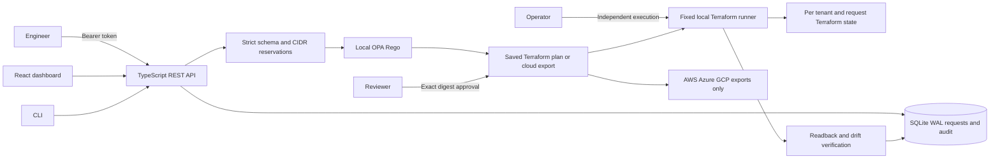
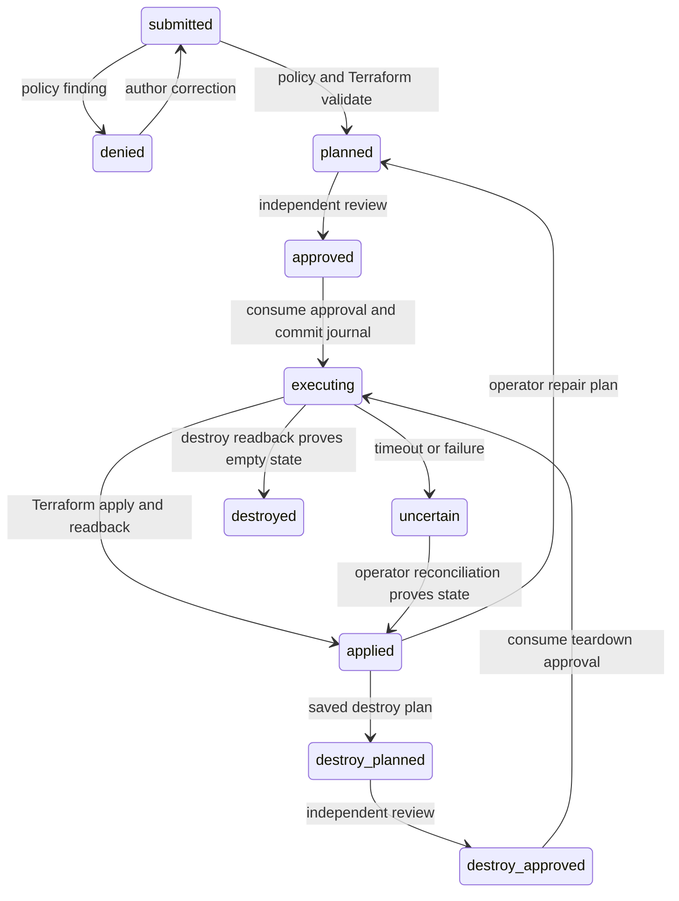
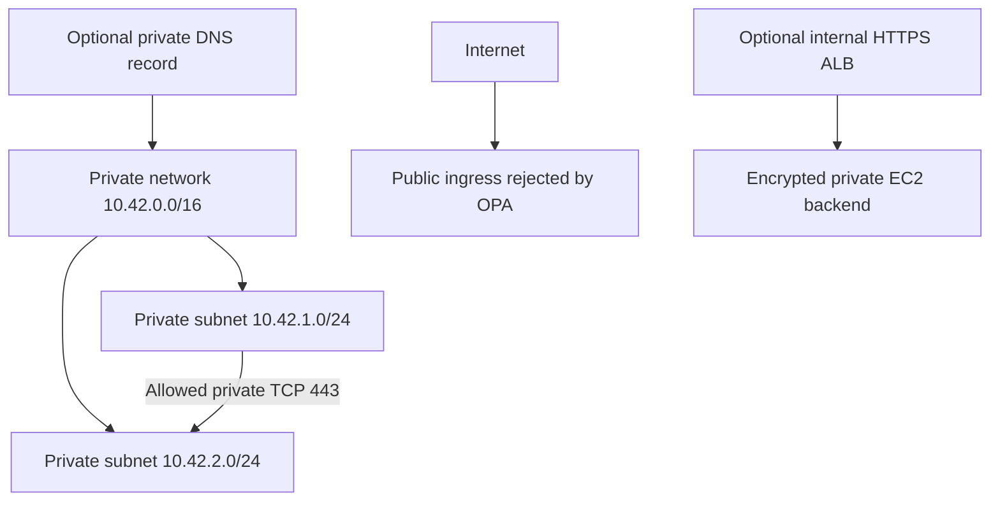

# Architecture and threat model

The last diagram describes validated configuration intent and the AWS adapter. The local Terraform module records that intent using terraform_data; it creates no actual network, VM, DNS server or load balancer.

Trust boundaries: browser and CLI input cross a bearer-authenticated API. The server administrator configures identities, trusted policy bytes, the fixed Terraform module and verified binaries. Each role is deny-by-default. Every lookup is tenant-scoped. Tenant and request workspace paths are derived from a tenant hash and server-generated UUID. Network reservations are transactional within each tenant. Cloud routing domains do not exist in this local service; a future shared routing domain needs reservations across its connected tenants.

OPA uses a copied policy file in a private temporary directory and an argument array, timeout and output limit. Terraform uses a fixed executable, fixed local module and generated tfvars, with no shell, provisioner, external provider or request-selected module. Cloud credentials, Terraform CLI argument overrides and provider configuration environment variables are not passed to the runner. User-provided tags reject Terraform expression syntax.

A plan digest binds operation, unique generation nonce, revision, request, policy, saved-plan hash, configuration hash, state hash, plan JSON and Terraform version. Approval expires after 15 minutes. Replanning always rotates the digest. Approval and execution require separate identities; neither may turn a cloud export into an execution artifact. Apply verifies hashes twice, executes only the saved plan, and reads Terraform state back before reporting completion. Teardown uses a fresh destroy plan and independent approval. Drift repair requires a fresh plan and approval too.

SQLite BEGIN IMMEDIATE transactions serialize state changes across connections. State and audit append commit atomically with FULL synchronization and WAL journaling. The execution-start record and consumed approval commit before Terraform runs. A crash leaves executing or uncertain state; further mutation is blocked until controlled reconciliation. Audit hashes detect modification of recorded events on startup, but cannot prove that a privileged filesystem operator did not truncate the chain or replace the database.

Tests cover denied public ingress and IAM escalation, tenant escapes, CIDR overlap, module injection, stale/replayed approval, missing teardown approval, modified plan/state artifacts, SQLite restart/rollback, uncertain completion, local drift and repair. Threats outside this release include compromised administrators, stolen bearer tokens, malicious local binaries, host disk access and denial of service against the synchronous runner. No live cloud trust boundary has been validated. Hosted deployment needs federated identity, TLS, external audit anchoring and encrypted durable storage.
