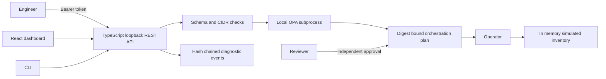
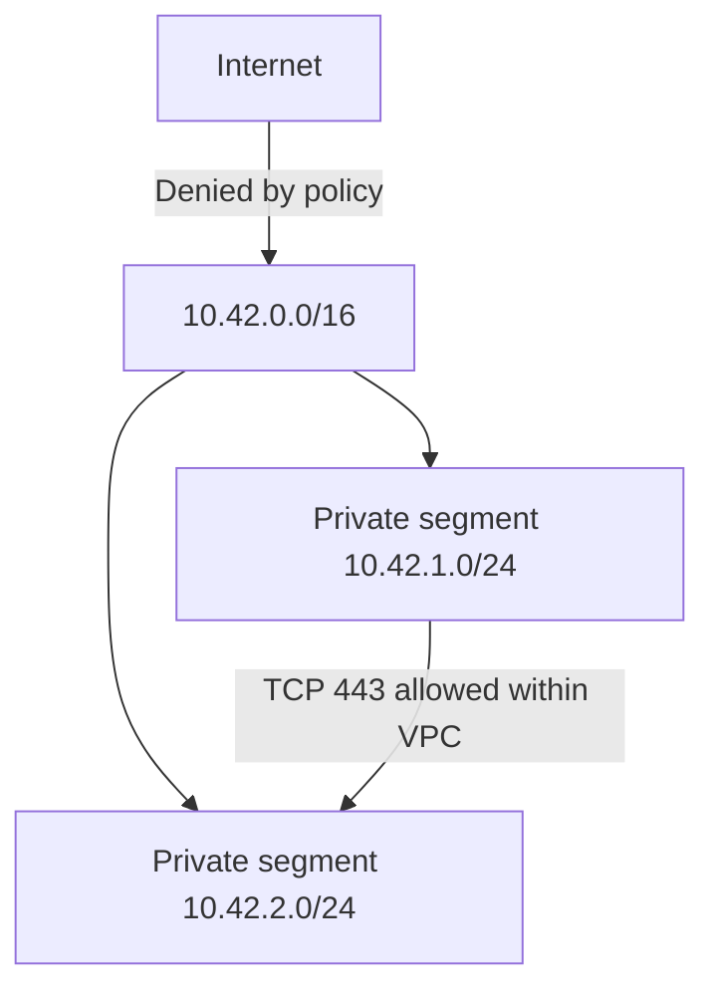

# Architecture and threat model

Trust boundaries: browser inputs and bearer tokens enter a loopback service. The operator configures identities and trusted local policy bytes. OPA is executed using a fixed executable and argument array with a timeout; no shell receives request content. Policy is copied into a private temporary directory. Requesters cannot choose a Terraform source or executable.

Threats addressed by tests include cross-tenant reads, self approval, unapproved apply, stale approvals, CIDR escape, network overlap, IAM action escalation and public ingress. Compromised workstation, stolen bearer tokens, malicious operators, memory tampering and policy-author compromise are outside this demo's protection.

Reservations are tenant-scoped. Tenant networks may overlap because the simulator has no shared cloud routing domain. Real cloud integration must enforce network overlap within the actual routing domain.
